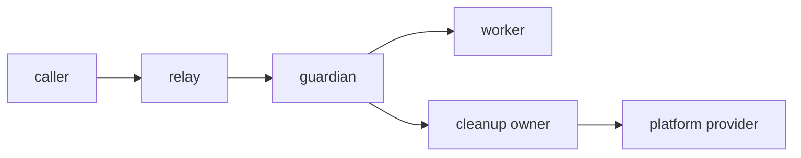

# umbra-isolation

Process custody and run isolation. **Current state:** macOS CLI runs in every
starting session and registered executable-library runs use the managed role
tree. **Scope:** this crate's `src/` and `tests/`. Other platforms do not activate
this topology. See [the CLI README](../umbra-cli/README.md#exit-codes-and-streams)
and [the platform README](../umbra-platform-macos/README.md) for their boundaries.

## Managed ownership and deadlines

The caller starts a relay, which owns the guardian. The guardian owns both the
worker and cleanup owner; only the cleanup owner holds the platform provider's
child handle. Each parent retains actual collection responsibility. The CLI
process itself becomes the relay; an executable-library caller remains separate.
The guardian starts a fresh session for a launchd caller; terminal callers retain
their controlling session and job-control behavior. Helpers release inherited
stdin/stdout after passing them on, and the worker releases its copies after
platform adoption so a live supervisor cannot delay program pipe EOF.
Provider admission, independent cancellation,
and direct Start/ACK routes are installed before durable Armed custody permits GO.



`umbra_core::managed::Ticket` uses the first observed cleanup trigger and negotiated capacity
`C`. Forwarding, progress, a lost acknowledgement and fallback never renew that
origin. The windows in `umbra_core::managed::CleanupPath` are:

| Path | Total allocation |
|---|---|
| Trusted cleanup | `26.35 + 4C` seconds |
| Notified failure | `30.6 + 8C` seconds |

The default `C` is 64 simultaneous obligations. Retiring work remains charged
until terminal proof; completed lifetime work does not consume capacity forever.
The Start publication/acknowledgement exchange shares 250 ms. Worker-only
abandonment stops the worker; custodians retain their children through their
original cleanup opportunities. Ordinary programs have no default age or
inactivity limit.

Runtime construction failures retain actual-parent custody: the owner closes
its startup endpoints and collects its adopted provider, and the relay collects
its guardian without repeating consumed preparation. Both reuse the existing
rollback allocation and retain the construction error as primary. Incomplete
collection remains a reported failure.

Managed startup and cleanup wait on descriptor readiness and process-exit
events. If a provider rollback watch cannot be allocated or installed, its real
parent first checks for collection. If the provider remains uncollected, the
parent requests its stop and polls with sleeps capped at one millisecond under
the original rollback cutoff; scheduling may delay those polls. An already
collected provider completes rollback; otherwise the watch error remains a
failure. Pre-GO helper rollback also retains parent collection if watch allocation
fails: bootstrap closure requests recursive rollback, and parent polling uses
the retained cutoff without allocating another watch. Expiry retains unresolved
custody, and successful collection still reports the allocation error.
Admission cancellation wakes a pending exchange to observe a shortened
cutoff. Observer traffic shares the guard wait with independent cleanup routes.
Each wake retains the original deadline. A route that acknowledged Start still
answers a concurrent Start while another route is pending; queued acknowledgments
must finish writing before publication completes.

An exit notification can arrive before a nonblocking parent wait returns a
status. Guards and the cleanup owner retain that collection work after consuming
the one-shot notification, yielding and polling again under the original stage
and ticket cutoffs. Only the actual parent wait establishes collection.
The `test-exit-before-wait` feature forces this ordering in unit tests and the
hosted shutdown-error case; the CLI forwards it for the own-session
paused-journal regression. The hooks hold collection until the parent loop has
consumed the exit notification, then defer one parent wait. These tests retain
their original cleanup assertions.

Worker collection retains unsolicited or invalid acknowledgement errors across
retries. After draining routes sequentially, it checks their readiness together
before returning, so a Start arriving on an already-scanned route is processed.
Only a complete exchange with no retained failure exposes a clean receipt.

Compared with the old isolated CLI, this topology adds one process; compared
with an old terminal CLI it adds three. An external library caller has four
helper/worker processes. `managed::topology::Topology` creates seven CLI socketpairs
(worker-owner, worker-guardian, guardian-owner, owner-provider admission,
owner-provider cancellation, worker-relay and owner-relay). The steady layout
accounts for 21 CLI descriptors: fourteen topology ends, three private process
queues and four parent-channel ends. Library notification adds four pairs,
a caller queue and two parent-channel ends, giving 32. The cleanup owner releases
its RPC copy after installing independent cancellation.

The parent channels remain necessary after startup for observer callbacks and
the worker's typed result. Against the original 19/28 budgets, the additional
ends are:

| Channel | Owning roles | Ends above the original budget |
|---|---|---|
| Guardian-to-relay result forwarding | guardian and relay | 2, CLI and library |
| Relay-to-caller result forwarding | relay and external caller | 2, library only |

Readiness snapshots measured 21/32 managed descriptors within the 22/33 ceilings.
Startup observations after releasing child-only parent copies measured a
conservative managed count of 24 CLI / 35 library. The owner accepts these
startup-only counts under the visit-11 measurement method; readiness ceilings
remain unchanged. Helper standard I/O is separately nine/twelve descriptors.
Sequential startup censuses observed 52/67 total descriptors across five/six
managed participants. These totals include legacy resources, and per-role maxima
occur at different stages. Discovery can miss a child before its first record;
the census is neither atomic nor proof of an absolute maximum. The
[resource report](../../experiments/fixtures/umbra-fix-299b-performance/checkpoint12-startup-resources.md)
retains the inventories and limits. The library caller returned to its original
descriptor inventory, including pre-GO rollback. Launchd-session costs require
CI qualification.

Complete helper readiness must arrive within the original two seconds, before
namespace preparation. Preparation has the original supervisor's lifetime;
waiting helpers observe parent closure, notifications and installed process
watches. The worker starts the single five-second durable-persistence allocation
after preparation and sends its exact cutoff on the existing route. GO forwarding
never renews it. Preparation failure starts the existing nine-second pre-GO
provider-collection budget once. Relay and guardian pre-GO rollback retain the
readiness-plus-nine-second cutoff while it is ahead. If preparation outlasted
that cutoff, each retained child receives one nine-second interval at failure.
Retries keep that same cutoff; rollback after GO remains refused. Expiry reports
uncollected custody as failure. These allocations are separate from D4 cleanup tickets.

Two limits remain explicit. Total loss of caller notification before any Start
has no proven finite caller-return bound (D1); custody stays unresolved without
an inactivity timer. Owner, guardian or relay death can orphan their children
(D7). Fallback reports failure within its ticket but cannot turn disappearance
or adoption into an actual parent wait. Late kernel creation and forced cleanup
of a stalled owner can also leave collection unconfirmed. The kernel case where
a tracer ends while holding a program remains outside this repair. These facts
cannot establish successful whole-run collection.

`managed_runtime::r2_da_order_across_roles` checks causal receipts across actual
parent waits with ordinary program and debugger stand-ins. Held operations,
terminal evidence and resource release prevent early cleanup or certification.
Shutdown-error, unwind and cancellation cases retain their failed results after
complete ordered collection; the emergency case also retains its unconfirmed
result. The native
Mach-right companion lives in `umbra-platform-macos`; these hosted stand-ins do
not establish native debugger behavior or SID-1 qualification.

The endpoint fixture captures the root inventory before topology creation and
matches later sockets by both stat fields and the platform socket identity.
Only the root may match that baseline; child roles still require assigned
endpoints. Unexpected sockets report domain, type and the queried process.
The managed endpoint, close-on-exec and nonce checks remain in place.

After collecting its managed children, a guardian that leads the run's session
uses the existing `sweep::end_run` drain and sweep for ordinary journal and storage
clients. This preserves their legacy contract without moving them into managed
custody. Terminal guardians that share the caller's session never sweep it.
The sweep retains its existing bounds and reports incomplete or unverifiable
cleanup loudly; it does not establish a parent wait for re-parented clients.
Only after a complete sweep may the guardian report its actual failed-worker wait
status over the existing observer channel. That report retains the committed
cleanup cutoff and cannot replace an interrupted observer exchange.
The CLI mirrors the status after collecting its guardian; external library
callers receive a failure. An own-session test covers the paused-journal case
through the `test-managed-session` test hook. The unchanged SID-1 case still
requires fresh CI qualification.

## Legacy launchd isolation

The remainder describes the retained #193/#205 implementation and its tests.
The macOS managed entrypoint above replaces its CLI activation. The legacy
`isolate_run()` path applies only to launchd's session; it is a no-op elsewhere.
The crate permits audited `unsafe` operations and denies
`unsafe_op_in_unsafe_fn`; CLI callers use safe entrypoints.

## The problem

A launchd job, or CI's self-hosted runner, starts `umbra` in session 1. The run's
processes then share a session with the caller's process group. Some of their
exits are not counted against that group's job-control count (XNU's uncounted
reparent to launchd, #186). A count that reaches 0 with a stopped member in the
group makes the kernel send SIGHUP and SIGCONT to the whole group. Measured on
master (7f551ba0), each of the following happened in session 1:

- P1: a stopped tracer at the run's deadline SIGHUPed `umbra`, its providers and
  the caller's group;
- P2: a tracer killed while its tracee's exit was pending did the same;
- P3: a killed platform provider drove the caller's group count to 0, an
  orphaned group;
- P4: a stopped provider, then the supervisor killed, SIGHUPed the providers and
  the caller's group.

## Topology

In session 1, `isolate_run()` does not return. The process the caller started
stays where it is, in the caller's group, as the **relay**. It spawns a
**guardian** into a new session S (`POSIX_SPAWN_SETSID`, so S is the guardian's
pid). The guardian spawns the **supervisor**, which is the same `umbra` binary
with the same arguments and the caller's environment (less the guardian's own
descriptors variable). Everything the supervisor starts (providers,
debugservers, the tracee) is in S. No exit in S can count against a group in
session 1.


The relay and the guardian talk over three pipes: guardian to relay, relay to
guardian, and a life pipe the relay never writes. The life pipe's EOF tells the
guardian the relay is gone. Messages are newline-terminated ASCII frames of at
most 1024 bytes, parsed strictly (`src/frame.rs`):

1. `ISOLATED <S>`: the guardian leads session S (its own pid; checked by the relay).
2. `GO <hex path>`: the relay has renamed the record to carry S (below).
3. `STARTED <pid>`: the supervisor was spawned.
4. `OUTCOME <wait status> <COMPLETE|INCOMPLETE|ERROR|UNVERIFIABLE> <record errno>`.
5. `FAIL <reason>`: startup failed.

A malformed or oversized frame, EOF, or a read error while the guardian is
still running is a lost peer, and the relay fails closed (below). A frame split
across read timeouts is kept and completed.

## Cleanup and ownership

A sweep kills every process of S by **audit token**, never by pid
(`proc_signal_with_audittoken`, `src/census.rs`). Each token is read from a task
name port before and after `getsid`. A process that exits and has its pid reused
fails the kernel's pid-version check, so the kill is refused as stale.

**Every sweep is debugger-last (#205).** Killing a debugserver while its
program is held (at an intercepted call, or with an exit pending) lets the
kernel hand the program to launchd as a zombie nobody ever collects: it stays
until a reboot and counts against the user's process limit (platform README,
"Ordered teardown"). So a run is ended in three steps (`sweep::end_run`):

1. **The supervisor first**, when it is still alive, by its own audit token,
   taken between two successful anchor checks (the anchor rule below); without
   that proof it is not signalled. The platform provider, whose owner it is,
   then tears its sessions down in
   order: only debugserver ends a held program, and debugserver is ended only
   once the program is gone.
2. **A drain:** wait until no live member of S is a debugserver and none is
   traced (`PROC_FLAG_TRACED`), capped at 3 s + 4 s per debugserver seen at the
   first readable reading (the platform's worst case, its emergency path
   included; 7 s until a reading succeeds). It sends no terminating signal. Its
   one signal is SIGCONT, at the first readable reading, to stopped members
   that are not traced (a stopped provider), by tokens enrolled under the
   anchor rule below; a failed reading delays it, and a failed anchor check
   ends it. Each member's start identity is bound to its verified token (read
   again after the token; on a mismatch the member keeps no token). The image names it uses
   (`debugserver`) are for waiting only; the platform provider's image is not
   used, so a substitute provider cannot end it early. Reaching the cap is
   recorded as `drain_exceeded`, and the sweep then goes ahead. Its known
   causes are a stuck provider, and a member traced by a debugger umbra does
   not own (a user's lldb attached to a child), which umbra cannot end in
   order.
3. **The sweep** of what is left, as below.

Afterwards every member the drain saw is checked, including those a census
cut at its deadline had already verified, and so is every member the sweep
signalled (a member created after the drain, say): one now a zombie under
launchd is reported in `launchd_zombies`, and the outcome is then not
`COMPLETE`. One whose final record cannot be read (a lookup failing other than
with `ESRCH`, or no recorded start) is not known to be clear: it is named in
the outcome's `error`, and the outcome is not `COMPLETE` either. A member the
drain could read only without a token has no recorded identity, so its pid is
checked instead: it is clear only when provably not a zombie under launchd now
(gone, or readable and not one), and otherwise named in `error` in the same
way.

Who ends the run:

- **Supervisor exit:** the guardian is the only process that waits on the
  supervisor. It drains and sweeps S and then sends `OUTCOME`. While the
  guardian runs, S exists (its leader is a member), so the guardian needs no
  further proof.
- **Relay gone** (life-pipe EOF): the guardian ends the supervisor (its own
  child) first, drains and sweeps S, reaps the supervisor within 1 s, records
  `relay-death` and exits.
- **Relay fallback** (the guardian stopped, lost, malformed or slow): the relay
  first SIGSTOPs a live guardian (recorded as `guardian-stop`, and what its
  bounded wait observed as `guardian-stopped`), so it cannot spawn a
  supervisor after the lookup. It names the supervisor (the pid
  `STARTED` reported, or, before `STARTED`, the guardian's only child in S,
  found while the guardian is still its unreaped child), then SIGKILLs the
  guardian by pid, but only while it is the relay's
  own unreaped child. It then ends the supervisor by token, drains and sweeps
  S, writes its `relay-fallback` line, reaps the guardian once, records the
  reap in a `guardian-reaped` line and exits 1.

The relay's sweep rests on the **zombie anchor**. The relay reaps the guardian
only after its sweep and that sweep's `relay-fallback` (or, on the normal path,
`outcome`) record line; the `guardian-reaped` line follows the reap. While the
guardian is
unreaped, its pid cannot be allocated again. A session id is its leader's pid.
So no other process can create a session with id S, and any process with
session id S belongs to this run. The XNU sources (xnu-12377.121.6), also
recorded in the #193 arc's T1 protocol (an external arc record, graph audit
`dg-56gcxqyw`, not in this repository):

- pid allocation skips pids still hashed, zombies included
  (`kern_fork.c:971-974`);
- `setsid` makes the caller a session leader (`kern_prot.c:498`,
  `setsid_internal` → `enterpgrp`), and `session_alloc` sets the session id
  to the leader's pid (`kern_proc.c:2801-2808`);
- the pid is released only at reap (`kern_exit.c:2981-2984`).

As defence in depth (`src/sweep.rs`):

- a process found in S is enrolled only in a census pass that both begins and
  ends with the anchor verified;
- from the first failed check, the owned set is frozen;
- any other process with session id S is reported `UNVERIFIABLE` and never
  signalled.

After the single reap, the relay performs no operation on a numeric pid or
session id (R-10): only the `guardian-reaped` record line, stderr, and its own
exit or mirrored signal follow it (`relay.rs`, `Relay::fallback`, end of
`run_with`).

The isolation does not reach a process that leaves S with its own `setsid()`. A
traced process that does so is still killed by its debugserver if the
connection to the platform is lost while it runs: `umbra-platform-macos` sends
`QSetDetachOnError:0` on every connection before attaching, and fails the
connection unless debugserver answers `OK` (platform README). If its tracer
dies while it runs, the kernel kills it (`kern_exit.c:2556-2608`). If its
tracer dies while it is held at a breakpoint or with an exit pending, the
kernel instead hands it to launchd as a zombie nobody collects (#205; platform
README). An untraced process that escapes S is not cleaned up.

## Exit status

When the run completes, the relay mirrors the supervisor's wait status: the same
exit code, or the same signal, re-raised. `umbra`'s own exit-code rules are
unchanged ([CLI README](../umbra-cli/README.md#exit-codes-and-streams)). The
relay exits 1 instead, with a line on stderr, in these cases:

1. the sweep ended other than `COMPLETE`, which includes a member left as a
   zombie under launchd (#205):
   `umbra: run isolation cleanup <KIND> (session S); supervisor status <N>`;
2. any record write or `fsync` failed, in the relay or the guardian:
   `umbra: isolation record write failed (guardian errno …, relay errno …); supervisor status <N>`;
3. the relay failed closed: `umbra: run isolation failed: <reason> (session S, relay sweep <KIND>)`;
4. the isolation could not start, and nothing was launched:
   `umbra: run isolation failed: <reason>`.

A terminating signal sent to the relay (a `launchctl remove`, for example) is
not a graceful stop. The relay installs no signal handlers, so it dies of the
signal, and its status is that signal. The guardian sees the relay gone, sweeps
S with SIGKILL and records it. Neither the relay nor the guardian handles SIGHUP.

## The isolation record

Every isolated run writes a JSON-lines record to
`~/Library/Logs/umbra/isolation/`. The home directory comes from the password
database (`getpwuid_r(getuid())`), not `$HOME`, so launchd jobs without `HOME`
are covered.

- **R-1:** the relay creates the record, as
  `isolation-<32 hex>.jsonl` with a random id from `getentropy`, and writes and
  `fsync`s its first line before anything is spawned. If it cannot, `umbra`
  exits 1 and launches nothing. Once the guardian reports S, the relay renames
  the record to `isolation-<32 hex>-s<S>.jsonl`. Session ids recur across runs,
  so S alone never names a record.
- **R-2:** each line is one checked JSON object, written with one `write` whose
  full length is verified, then `fsync` (not `F_FULLFSYNC`).
- **R-3:** a failed write or `fsync` is sticky in the process that saw it. The
  guardian forwards its errno in `OUTCOME`. The run itself is not killed for a
  reporting failure; only its reported status becomes 1.
- **R-4:** if the relay is dead **and** the record is unwritable, the guardian's
  inherited stderr is the only report:
  `umbra: run guardian: relay gone, cleanup <KIND>, isolation record write failed (errno N)`.
  This is a limit of the design, not something it hides.
- **Ending fields (#205):** the `sweep`, `relay-death`, `wait-error` and
  `relay-fallback` lines carry `launchd_zombies` (pids of members left as
  zombies under launchd) and `drain_exceeded`; `relay-fallback` also carries the
  `supervisor` it ended first, if any.
- **Retention:** at relay start, only the newest 50 records are kept. Only
  regular files in that directory whose names match the record pattern exactly
  are deleted.

The record is not linked to the run's journal.

## Bounds

The bounds are operational targets on the monotonic clock, not hard real-time
guarantees (#193 O7). Each wait below is a `WNOHANG` or `poll` loop against a
deadline:

| Wait | Bound |
|---|---|
| each startup handshake phase (`ISOLATED`, then `STARTED`) | 2 s |
| the drain before a sweep (#205; until no live debugserver or traced member) | 3 s + 4 s per debugserver at its first readable reading; `drain_exceeded` when reached |
| a sweep (census passes, kills, pauses) | 3 s, plus the overrun below |
| the guardian's reap of the supervisor after relay death | 1 s |
| the guardian's exit after its `OUTCOME` | 1 s |
| the relay's wait for a SIGSTOPped live guardian to stop, before it names the supervisor (#205) | 1 s |
| the relay's wait for a SIGKILLed guardian to exit | 1 s |
| the relay's reap of the guardian | 1 s |

A sweep checks its deadline in two places: at the top of each pass, and before
each process of a census (`sweep.rs`, `census.rs`). Each of these steps runs to
completion once it has started:

- **the two anchor checks** of each pass (`anchor_ok`), one before the census
  and one after it. In the relay's fallback sweep each is one
  `waitid(…WNOWAIT…)` call on the guardian; the guardian's own sweep answers
  them without a call;
- **the process listing** at the start of each census: up to eight
  `proc_listallpids` calls (`all_pids`);
- **one process's census step:** `getsid`, `proc_pidinfo`, then either
  `task_name_for_pid`, two `task_info` reads around a second `getsid`,
  `mach_port_deallocate` and sometimes a third `getsid` (`verified_token`), or,
  when `proc_pidinfo` gives no answer, one more `getsid` (`MacHost::census`);
- **the kill loop:** one `proc_signal_with_audittoken` per owned process still
  alive, with no deadline check inside it;
- **the 20 ms pause** after each pass, including a pass whose census failed.

A sweep can therefore end later than its 3 s. At most, the overrun is the
composition of: the step in progress at the deadline, then the post-census
anchor check, then that pass's kill loop, then one 20 ms pause. A census cut at
the deadline counts as failed, never as empty, and so does a process whose
`proc_pidinfo` gives no answer but whose `getsid` still names S: it is reported
as a claimant without a token, which is never signalled. Only an empty census
ends a sweep `COMPLETE`; otherwise the result is `UNVERIFIABLE` or
`INCOMPLETE` from the last complete census, or `ERROR` if none completed.

The relay's reap of the guardian is bounded too. If a SIGKILLed guardian has
not been reaped within 1 s, for example because it is still inside an
uninterruptible call, the relay exits 1 without reaping it, saying so on stderr
and in the record's `guardian-reaped` line (`"reaped": false`), and launchd
inherits it. The reap still comes after the sweep and its `relay-fallback` or
`outcome` line, and nothing after it signals or censuses by number.

Outside every bound:

- **Record I/O.** Each record line is a blocking `write` plus `fsync` to a local
  disk. It happens outside the sweep: after it in the guardian and in the
  relay's fallback, and around the handshake in the relay. A stalled disk
  delays the report and the exit, never a sweep's own deadline checks.
- **Scheduling delay** of the relay or the guardian.
- **Pipe writes.** Over a whole run, the guardian writes at most three frames
  (`ISOLATED`, `STARTED`, then `OUTCOME` or `FAIL`), and the relay writes one
  (`GO`). Each frame is at most 1025 bytes, well under a pipe's 16 KiB buffer,
  so no write can block even if the reader never reads.
- **The run's own duration**, unbounded as before: the relay waits for the
  guardian for as long as the supervisor runs.

## Spawning and signals

No process here ever calls `fork()`. The relay and the guardian start their
children with `posix_spawn` of the `umbra` executable itself (`src/spawn.rs`),
so no child ever runs in a forked copy of a multi-threaded process.

- **Descriptors:** the three pipe ends a child needs are passed with
  `posix_spawn_file_actions_addinherit_np`, which `libc` does not bind. Measured
  on this host, `adddup2(fd, fd)` does not clear close-on-exec. Every other
  close-on-exec descriptor stays closed in the child.
- **Signals:** the Rust runtime ignores SIGPIPE in the relay and the guardian.
  `POSIX_SPAWN_SETSIGDEF` resets it to the default in the child, so the
  supervisor and everything it starts never inherit that suppression. Every
  other disposition and the signal mask are inherited exactly as `execve` would
  inherit them.

## Residuals

Stated, not closed here:

- **The relay stays in the caller's group.** If that group is orphaned by
  something outside the run, the relay is signalled as `umbra` was before. Its
  death then cancels the run through the guardian's sweep.
- **Double failure** (#199): if both the relay and the guardian are killed,
  nothing sweeps S, and its processes can outlive the run. They are in a session
  other than 1, so #193's SIGHUP cannot reach them. The platform also keeps such
  a run alive until its own deadline (#203).
- **Other debugserver detach routes** (#200): only the RSP-loss route is
  governed, by the verified `QSetDetachOnError:0`; any other route by which
  debugserver might detach with that setting has not been audited.
- **No caller plus an unwritable record:** R-4 above.
- **Session continuity in the relay's fallback** (the design's R-9, as amended
  by the T1 resolution): continuity of S is proved by the zombie anchor, not by
  a registry of members. A process found in S without a readable audit token
  is reported `UNVERIFIABLE` and never signalled, so it can outlive the run.
- **Only `umbra run` is isolated.** `umbra resume` and `umbra providers` also
  start provider processes, with no tracee, and stay in the caller's session.
- **A tracee that leaves S** with its own `setsid()` is cleaned up through its
  debugserver (the verified `QSetDetachOnError:0`; platform README). That
  route was measured in the #193 design readings, where umbra already sent the
  packet; no test in this repository exercises it on the shipped binary.
- **A rejected `QSetDetachOnError:0` fails the connection**, but no test injects
  a rejection: the suite has no scripted debugserver. The success path runs on
  every connection to the real one (every `umbra run`, and
  `umbra-platform-macos`'s handshake test), and the handler that answers `OK` is
  `RNBRemote.cpp:2429-2447` (swift-6.3.2).

## Tests

- `src/*` unit tests:
  - frame parsing, including partial, malformed and oversized frames;
  - record lines, short writes, `fsync` failure and retention;
  - the sweep's interleavings, scripted: the last witness lost mid-sweep, a
    registry refresh after the loss, and a reused pid or unknown claimant never
    signalled;
  - the debugger-last ending (#205), scripted: the supervisor is ended before
    any sweep kill, on every path that can name it (the relay's fallback
    included); the drain waits to its cap while a debugserver lives, ends at
    once with nothing to wait for, continues only stopped untraced members
    (still after a failed first reading), and scales its cap with the
    debugserver count; a member left as a zombie
    under launchd is reported and keeps the outcome from `COMPLETE`, and so
    does one whose final check cannot be read (named in `error`);
  - spawn: no SIGPIPE inheritance, a new session, exact descriptor passing.
- `tests/t1_kernel.rs`, on the real kernel:
  - with the anchor forced off, claimants are reported `UNVERIFIABLE` and not
    signalled, and with it held they are killed (the frozen-set half of T1);
  - a stale token is refused;
  - the supervisor is not signalled with the anchor forced off, and is killed
    by its token with it held (#205);
  - a sanity check that a zombie leader stays a zombie while new sessions are
    created. It attempts no pid reuse, so it does not show the anchor.
- The anchor-held half of T1 (no process can obtain a zombie leader's pid or
  session id) is not a CI test. It rests on the XNU source cited under
  Cleanup and ownership, and on one recorded reading of the #193 arc that
  wrapped the whole pid space past a held zombie.
- `tests/relay_process.rs`: the real relay against a scripted guardian. It
  covers:
  - the mirrored statuses and O5's exit 1 cases;
  - the fail-closed transitions that a scripted guardian can produce (EOF,
    malformed, oversized and unknown frames, a stopped, silent, hung or
    exited guardian, a wrong session claim);
  - a live guardian observed stopped (`guardian-stopped` with `Stopped`)
    before its kill, in the fallback (#205);
  - the bounds.

  Every case that starts a guardian also checks that the single reap is the
  record's last line, that it reaped, and that no signal follows it. Permanent
  `waitid` and `poll` errors also fail closed in code, but they are not
  injected.
- `tests/guardian_process.rs`: the real guardian against a fake relay. It covers
  the sweep on supervisor exit and on relay death, a mid-run record failure in
  `OUTCOME`, and R-4's stderr line.

The production-path tests in session 1 (P1-P4, topology, cleanup, and
debugserver's arguments left as on master) and the terminal tests are `umbra-cli`'s
`tests/isolation.rs`. It identifies the worker and cleanup owner separately,
checks each provider's actual parent, and validates managed collection receipts
against kernel birth identities. The fresh-session guard passed with
`shutdown-witness` enabled on the test command. SID-1 qualification belongs to CI's self-hosted runner with
`UMBRA_REQUIRE_SID1=1`; a worker terminal session must not submit a launchd job
to obtain that prerequisite.

```sh
cargo test -p umbra-isolation
```
